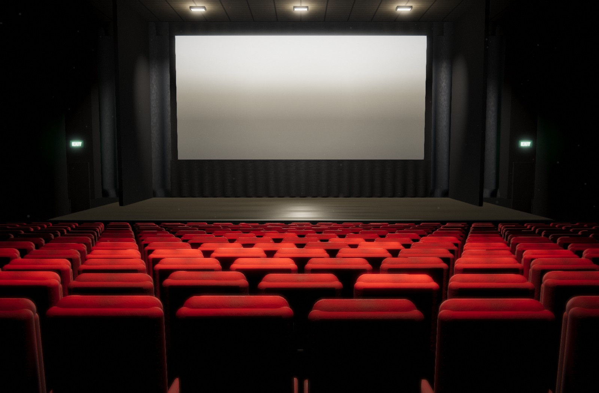
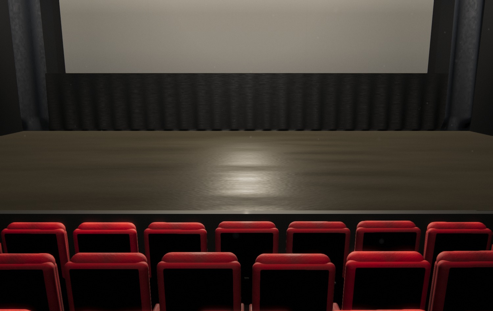
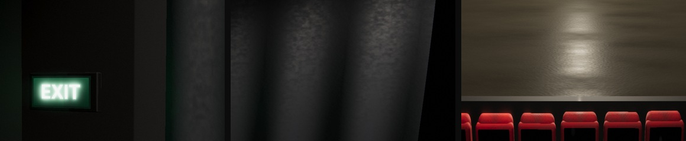
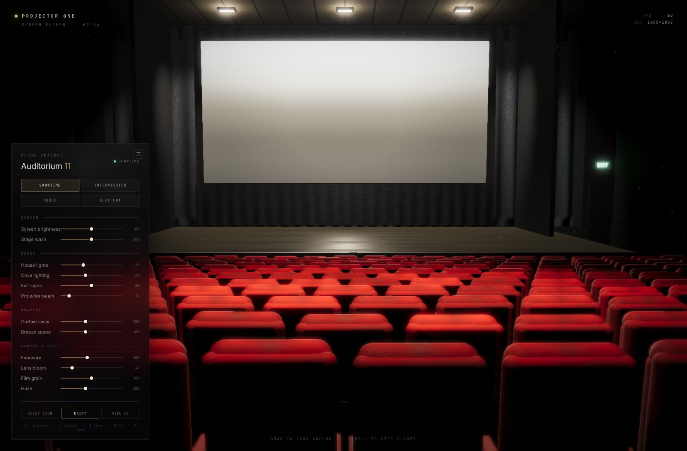
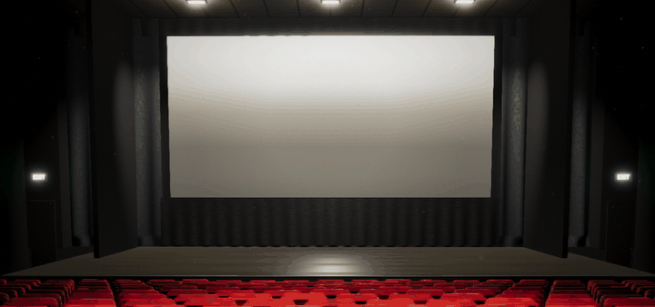
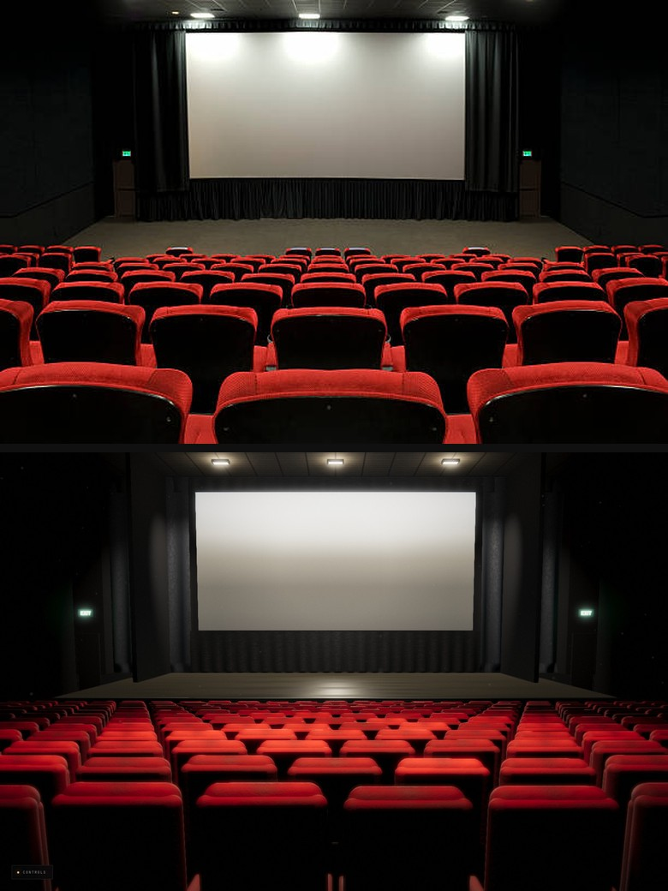
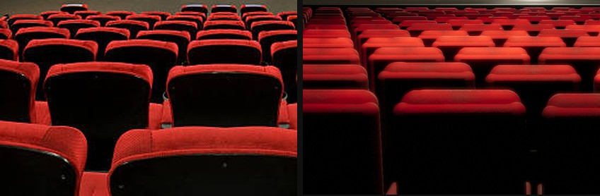
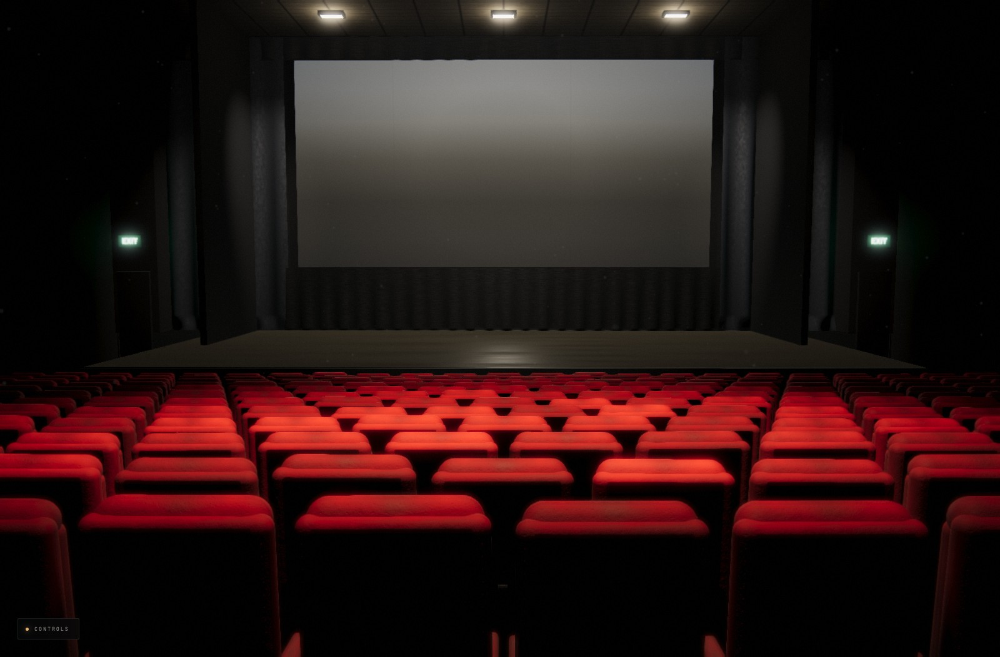
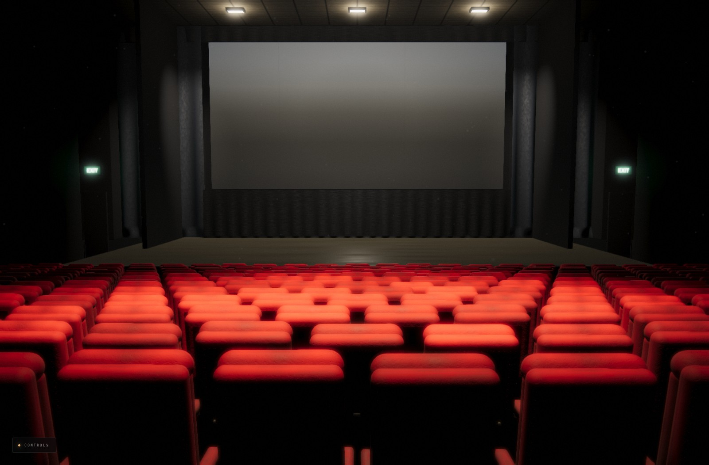

<div align="center">

# PROJECTOR ONE

**A photoreal cinema auditorium, generated entirely in code — no models, no textures, no photos.**
Runs in the browser at 60 fps on a single HTML file.

[](https://abhinav-prabhakar.github.io/Projector/)

[](https://threejs.org/)
[](#)
[](https://vite.dev/)
[](#performance)
[](https://github.com/Abhinav-Prabhakar/Projector/actions/workflows/deploy.yml)
[](LICENSE)

</div>



---

## From the front row





<div align="center"><sub>Exit signage · pleated velour · the apron, worn and lit</sub></div>

---

## The house console

Ten live controls, four presets. Nothing is baked — every light, every curtain and every grade parameter moves in real time.



| Preset | What it does |
| :-- | :-- |
| **Showtime** | Screen up, house down, projector shaft in the haze |
| **Intermission** | Screen fades, cove and stage wash come up |
| **House** | Full house lights, everything lit |
| **Blackout** | Only the exit signs and the screen |

`Screen · Stage wash · House · Cove · Exits · Beam · Sway · Breeze · Exposure · Bloom · Grain · Haze · DOF`

---

## Cloth that moves

Heavy velvet legs, valance and stage skirt, displaced analytically in the vertex shader —
pleats, breeze and a pinned hem, with normals rebuilt every frame so the folds stay lit.



---

## Matched to the reference

The brief was one photograph. Geometry, light placement and tone curves were measured against it
band by band — apron luminance, seat-field percentiles, red-channel saturation, ceiling falloff.



<div align="center"><sub><b>Reference (top)</b> · <b>Procedural render (bottom)</b></sub></div>



<div align="center"><sub>276 instanced seats · velvet sheen · baked per-vertex occlusion · black shell insets</sub></div>

---

## Other rooms, same geometry

<table>
<tr>
<td width="50%"><div align="center"><sub><b>Screen down</b> — exit signs carry the room</sub></div></td>
<td width="50%"><div align="center"><sub><b>House up</b> — stalls, rakes and aisles</sub></div></td>
</tr>
</table>

---

## Under the hood

- **Everything procedural** — canvas textures for velvet, carpet, acoustic tile, concrete, brushed metal; geometry built from primitives at load time.
- **HDR pipeline** — HalfFloat scene target → FXAA → soft-knee bright pass → dual-radius bloom → ACES composite with barrel distortion, chromatic aberration, vignette, halation, display-referred grain and a 16-tap depth-of-field.
- **Real light** — 29 lights, one shadow caster, bounce and spill approximated by tuned spot and area lights plus a baked apron wash.
- **Deterministic** — a single paused timeline, seek-safe animation, no accumulated drift.
- **Adaptive DPR** — resolution floats to hold 60 fps on the host GPU.

## Run it

```bash
npm install
npm run dev      # http://localhost:5199
npm run build    # single self-contained index.html in dist/
```

Drag to look around · scroll to step closer · `1`–`4` presets · `L` lights · `B` beam · `H` UI.

## Performance

| | |
| :-- | :-- |
| Draw calls | ~100 |
| Triangles | 6.6 M / frame |
| Lights | 29 |
| Frame | 1600 × 1052 @ 60 fps (Apple GPU, Metal/ANGLE) |

<div align="center"><sub>Built with three.js. No assets were harmed.</sub></div>
